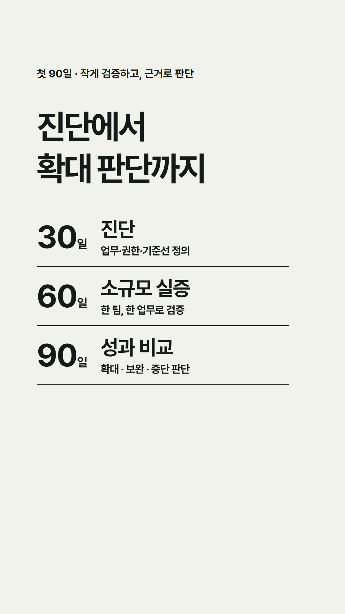
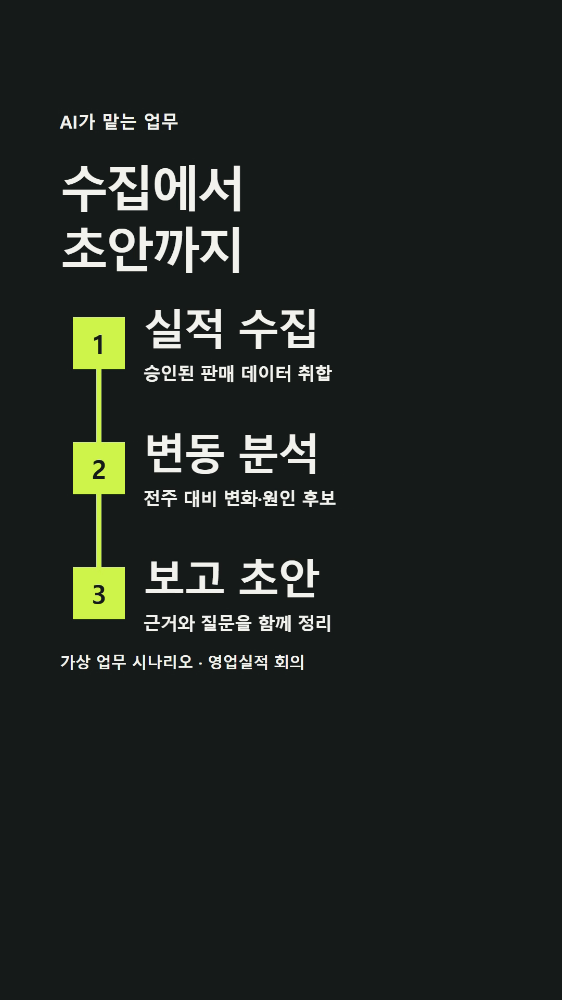

# AI Motion

## 에이전트 경영 EP03 — CEO의 첫 90일

AI에게 맡길 업무 하나, 권한과 책임, 성과 기준을 정하고 30일 진단 → 60일 소규모 실증 → 90일 성과 비교와 확대 판단으로 연결합니다.

- 60초 · 세로 1080×1920 · 30fps · Pretendard Bold
- 키네틱 타이포그래피 · 진취적인 126BPM 음악 · 내레이션 없음
- 마지막 5초: IGM 공식 로고, C레벨의 에이전트 경영 메시지, [www.igm.or.kr](https://www.igm.or.kr)
- “No.1을 향한 기업교육 파트너”는 지향점을 담은 카피입니다.

[EP03 공개 재생](https://mihyunahn.github.io/ai-motion/videos/agent-management-ep03.mp4) · [파일 다운로드](videos/agent-management-ep03.mp4)

음악: “Motivator” — Kevin MacLeod ([incompetech.com](https://incompetech.com/music/royalty-free/index.html?Search=Search&isrc=USUAN1100803)), [CC BY 4.0](https://creativecommons.org/licenses/by/4.0/).
16–76초 발췌, 음량 정규화·페이드 적용. [출처 전문](videos/EP03-CREDITS.txt)

## 에이전트 경영 EP02 — AI가 일하는 회사

월요일 영업실적 회의의 가상 시나리오입니다. AI가 승인된 데이터를 수집하고 변동을 분석해 보고 초안을 준비합니다. 직원은 근거를 검증하고, 팀장은 우선순위를 정하며, 임원은 최종 판단을 맡습니다.

- 60초 · 세로 1080×1920 · 30fps
- 키네틱 타이포그래피 / AI 파티클 / 업무흐름 그래픽 / 배경음악
- Pretendard Bold · 밝고 희망적인 전자음악
- 가상 업무 시나리오 · 내레이션 없음
- 계약과 고객 발송은 사람의 승인 후 진행

[EP02 영상 다운로드 및 재생](videos/agent-management-ep02.mp4)

EP02 음악: “Cipher” — Kevin MacLeod ([incompetech.com](https://incompetech.com/music/royalty-free/index.html?Search=Search&isrc=USUAN1100844)).
Licensed under [Creative Commons Attribution 4.0](https://creativecommons.org/licenses/by/4.0/).
원곡의 12–72초 구간 발췌, 음량 정규화 및 페이드 적용. [EP02 출처 전문](videos/EP02-CREDITS.txt)

수정본: 영상 내 ‘가상 업무 시나리오’ 문구 제거, 음악 출처는 작은 글자로 마지막 장면 하단에 배치.

## 에이전트 경영 EP01 — AI 활용과 AX 성과의 차이

직원의 작업 속도와 회사의 의사결정 속도는 왜 다를까요? AI에게 승인된 범위의 업무를 맡기고, 사람은 목표·검증·판단·책임을 맡는다는 메시지를 담았습니다.

- 60초 · 세로 1080×1920 · 30fps
- 키네틱 타이포그래피 / AI 파티클 / 배경음악
- 내레이션 없음

[영상 다운로드 및 재생](videos/agent-management-ep01.mp4)

### 음악 출처

“The Complex” — Kevin MacLeod ([incompetech.com](https://incompetech.com/music/royalty-free/index.html?isrc=USUAN1300025))  
Licensed under [Creative Commons Attribution 4.0](https://creativecommons.org/licenses/by/4.0/).  
변경: 원곡의 65–125초 구간 발췌, 음량 정규화 및 페이드 적용.

영상 재게시 시 음악 출처와 라이선스 표기를 유지하세요.
